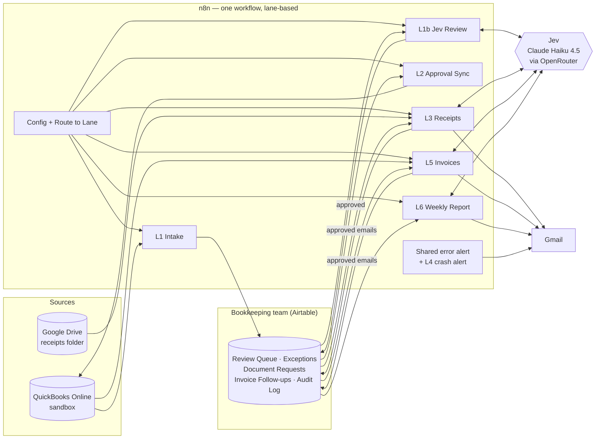
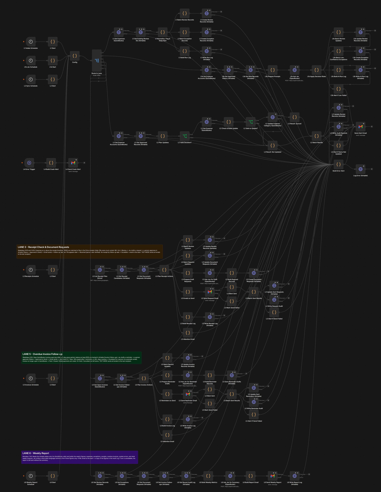
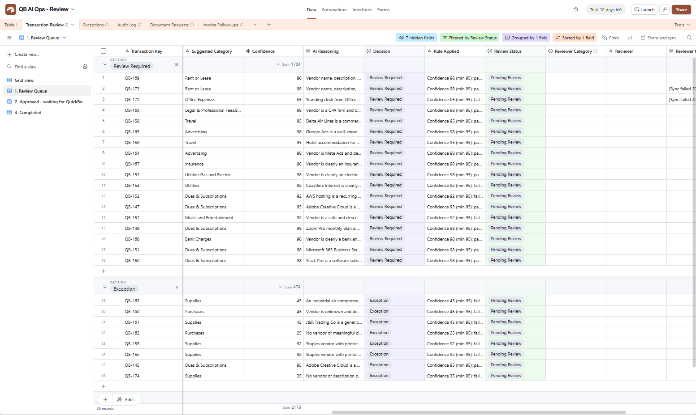
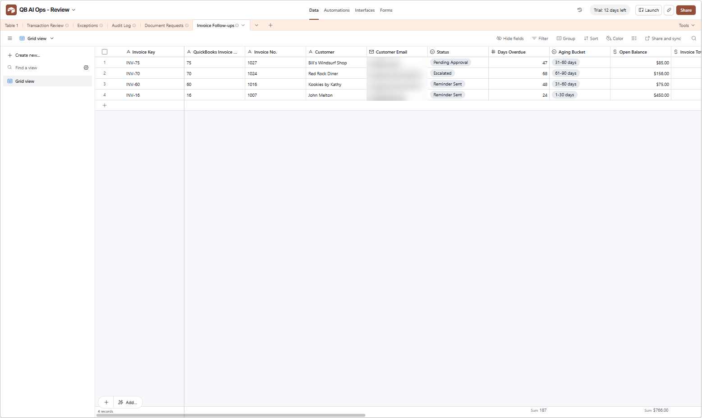
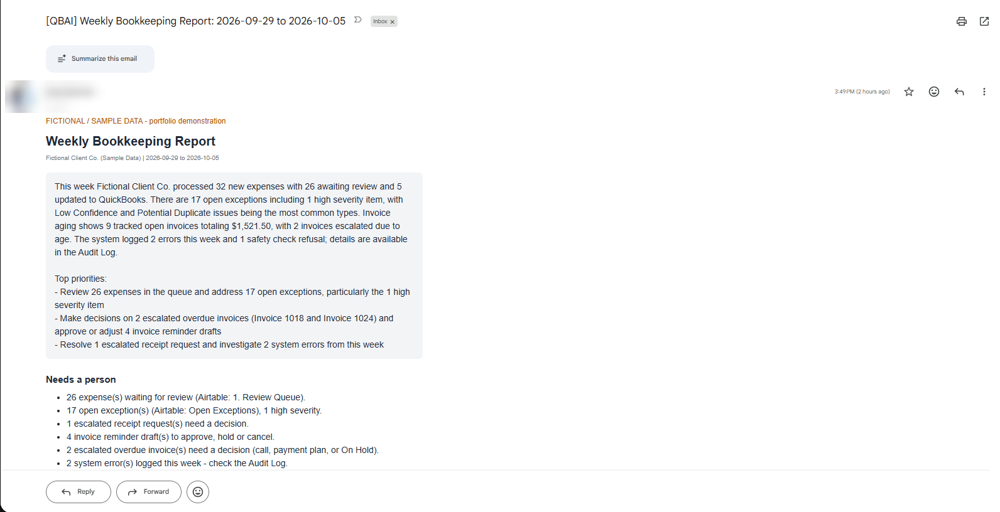

# QuickBooks AI Operations Assistant

**AI-powered bookkeeping operations and exception management for small bookkeeping firms.**
Built with n8n, QuickBooks Online, Airtable, Google Drive, Gmail and Claude (via OpenRouter).

> **Fictional / Sample Data.** This is a portfolio project. It runs against an Intuit QuickBooks Online **sandbox** company and fictional sample data. No real client or financial information is used.

---

## The business problem

Small bookkeeping firms lose hours every week on repetitive work that still needs professional judgment:

- **Uncategorized transactions.** Bank-feed expenses land in "Uncategorized Expense" and wait for someone to categorize them one by one.
- **Errors that slip through.** Duplicates, missing vendors, missing descriptions and unusually large amounts are easy to miss in a long list.
- **Missing receipts.** Expenses above the firm's receipt threshold have no supporting document, and chasing clients by email is manual.
- **Overdue customer invoices.** Nobody follows up consistently, and reminders depend on someone remembering.
- **No weekly view.** The team lead has no single summary of what is waiting, what is overdue and what failed.

## What the system does

One n8n workflow, organised into **lanes** that each run on their own schedule:

| Lane | Schedule (Asia/Manila) | What it does |
|---|---|---|
| **1 – Transaction Intake** | Weekdays 8:00, 13:00 | Reads expenses waiting in QuickBooks' holding account ("Uncategorized Expense"), skips ones already queued, and flags potential duplicates, missing vendor/description, large amounts and multi-line expenses. Writes them to an Airtable review queue. |
| **1b – Jev Review & Decision** | Weekdays 8:15, 13:15 | **Jev** (the AI assistant, Claude Haiku 4.5) suggests a category with a confidence score and reasoning. Business rules decide: **auto-approve** only when every safety condition passes; otherwise the item goes to a person. |
| **2 – Approval Sync** | Weekdays every 2 hours, 8:30–18:30 | Takes items a person approved (or auto-approved), validates the decision, re-reads the expense from QuickBooks, and updates **only the category**. If anything looks wrong, it refuses and explains why. |
| **3 – Receipts & Document Requests** | Weekdays 9:00, 14:00 | Matches expenses of **$100 or more** to receipt files in a Google Drive folder. For missing receipts, Jev drafts a request email; **a person approves it** before Gmail sends it. Tracks Requested → Received → Verified, and escalates when the follow-up date passes. |
| **4 – Crash Alert** | On failure | If a live run crashes unexpectedly, the team gets an email with the workflow, execution ID, failing step and error. |
| **5 – Overdue Invoice Follow-up** | Weekdays 9:30 | Tracks past-due customer invoices (after a 3-day grace period, balance at least $25). Jev drafts a polite reminder; **a person approves it**; follow-up after 7 days; **escalates to a person** after 2 reminders or 60+ days overdue. Detects payments and partial payments. |
| **6 – Weekly Report** | Mondays 7:45 | Builds the week's figures from Airtable, and Jev writes a short plain-language summary from those figures only. The team receives an HTML email with a "Needs a person" list. |

### Design principles

- **The AI recommends; business rules and people decide.** Jev never changes QuickBooks by itself and never sends an email to a client or customer.
- **Auto-approval is narrow.** It applies only when: confidence ≥ 95, **and** the same vendor was previously approved with the same category, **and** the amount is under $500, **and** there are no exception flags.
- **QuickBooks stays the source of truth.** Updates are category-only, re-checked against QuickBooks just before writing, and never repeated.
- **Potential duplicates are flagged, never deleted or reversed.**
- **Every action is logged.** Run logs, AI reviews, QuickBooks updates, emails and errors are all written to an Audit Log.
- **Test mode.** While testing, every outgoing email is redirected to a test address and marked `[FICTIONAL TEST]`.

## Architecture



## Screenshots

Fictional / sample data; private details blurred. Try the **interactive demo** on the [portfolio page](index.html) (a browser simulation with fictional data, using the same rules), or browse the [screenshots folder](screenshots/).



| Review queue with Jev's suggestions | Overdue invoice follow-ups | Weekly report |
|---|---|---|
|  |  |  |

## Data structure (Airtable)

| Table | Purpose | Key statuses |
|---|---|---|
| **Transaction Review** | One row per expense waiting for a category. AI suggestion, confidence, reasoning, the rule result, the reviewer's decision, receipt status. | New → Pending Review → Approved / Changed / Rejected → Synced / Sync Failed |
| **Exceptions** | Flags that need attention: Potential Duplicate, Missing Vendor, Missing Description, Large Amount, Multiple Lines, Low Confidence. Severity Low / Medium / High. | Open → resolved by a person |
| **Document Requests** | Missing-receipt requests with Jev's draft email. | Pending Approval → Approved to Send → Requested → Received → Verified (side statuses: Escalated, Send Failed, Cancelled) |
| **Invoice Follow-ups** | Overdue invoices, aging bucket, reminder count, Jev's draft reminder. | Pending Approval → Approved to Send → Reminder Sent → Escalated or Paid / Closed (side statuses: Send Failed, On Hold, Cancelled) |
| **Audit Log** | Every run, AI review, QuickBooks update, email, weekly report and error. | Success / Failed |

## AI logic (Jev)

| Task | Input | Output | Who decides |
|---|---|---|---|
| Categorize an expense | Vendor, amount, date, description, and the **list of active QuickBooks expense accounts** | Category (must be from the list), confidence 0–100, reasoning, concerns | Business rules (auto-approve gate) or a person |
| Draft a receipt request | Vendor, amount, date, description | Subject + body (no invented facts, deadlines or policies) | A person approves, edits or cancels |
| Draft an invoice reminder | Invoice number, balance, due date, days overdue, reminder number | Subject + body (friendly first, firmer second; no threats, fees or legal language) | A person approves, edits, holds or cancels |
| Weekly summary | The week's figures (JSON) | 3–5 sentences + top priorities, using only the given numbers | Informational only |

If the AI is unavailable or returns something invalid (a category outside the allowed list, or an out-of-range confidence), the item goes to human review. Drafts fall back to a fixed template, and the weekly report is sent without the summary.

## Error handling

- Every external step (QuickBooks, Airtable, Drive, Gmail, OpenRouter) retries automatically, then sends failures to a **shared error alert**. That alert emails the team and writes an Error record to the Audit Log, with headers, cookies and tokens stripped out.
- **Lane 4** catches unexpected crashes of live runs.
- Approval sync safety checks: invalid reviewer input, an expense no longer in the holding account, or an inactive category means **no update** — the item is marked Sync Failed with a plain-language reason.
- Email send failures mark the item **Send Failed**, add a note and send an alert. Nothing is counted as sent.

## Testing

All features below were run end to end against the QuickBooks sandbox with fictional data and checked in the n8n execution logs. See [docs/test-results.md](docs/test-results.md).

| Feature | Status |
|---|---|
| Transaction intake, flags, no-duplicate re-runs | TESTED |
| Jev categorization + decision rules, AI-failure fallback | TESTED |
| Human review → category-only QuickBooks update, double-update guard | TESTED |
| Auto-approval path end to end | TESTED |
| Receipt check, request drafts, approval, send, Received, Escalated | TESTED |
| Overdue invoice tracking, reminders, approval, send, follow-up, escalation, paid, partial payment, On Hold | TESTED |
| Weekly report | TESTED |
| Bad reviewer input, email send failure, Airtable failure alert, live crash alert | TESTED |
| Receipt-request send failure (same logic as invoice reminders) | IMPLEMENTED, not separately tested |

## Business impact — what is measured and what is not

**Measured (sandbox):**
- AI cost was about **$0.001 per transaction** reviewed (Claude Haiku 4.5 via OpenRouter).
- The weekly report needs about 6 Airtable API calls a week and no QuickBooks calls.

**Not measured:** time saved, error reduction or AI accuracy on real client data. The sandbox data is fictional, so this project makes **no claims** about those. A firm piloting the system can measure them with the Audit Log:
- minutes per expense before vs. after;
- share of items auto-approved vs. changed by a reviewer;
- receipts collected per week;
- days-to-payment on reminded invoices.

## Known limitations

- QuickBooks bank-feed **"For Review"** items are not available through the QuickBooks API, so the system works on expenses already posted to a holding account.
- Airtable's free plan allows 1,000 API calls a month. This build stays within it (schedules are tuned for that), but a busier firm needs a paid plan.
- The weekly AI summary can occasionally add an explanation that isn't in the data. The figures in the report tables come straight from Airtable and are the source of truth.
- Receipts are matched by the QuickBooks ID in the file name (e.g. `QB-172 Office Depot.pdf`). The system does not read receipt contents.

## Tech stack

n8n (self-hosted) · QuickBooks Online API (OAuth 2.0, sandbox) · Airtable (REST + Meta API) · Google Drive API · Gmail · OpenRouter (Claude Haiku 4.5)

## Repository contents

```
README.md                       This file
docs/test-results.md            Test evidence (fictional data)
workflows/qbai-operations-assistant.sanitized.json
                                Sanitized n8n export: all IDs, emails and credentials
                                replaced with YOUR_... placeholders / example.com
index.html                      Portfolio page (GitHub Pages) with an interactive demo
screenshots/                    Sanitized screenshots
```

The workflow export is a **sanitized example** for review. To run it you need your own QuickBooks app, Airtable base (with the tables above), Google Drive folder and API credentials, and you must replace every `YOUR_...` placeholder in the **Config** node.

---

Michael Mendoza • mjmendoza.workph@gmail.com
